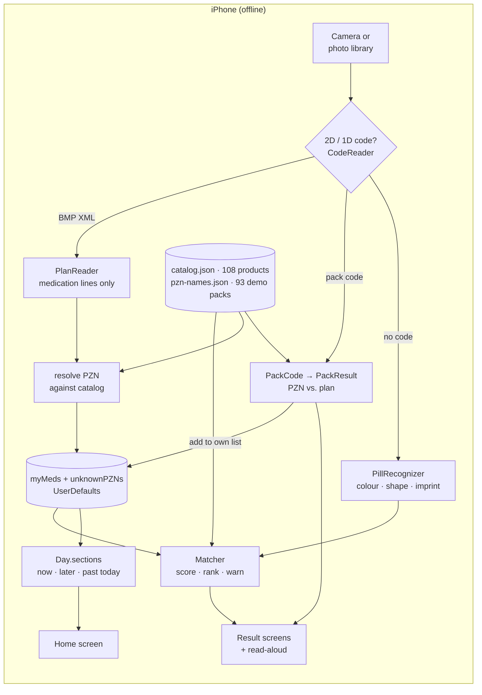
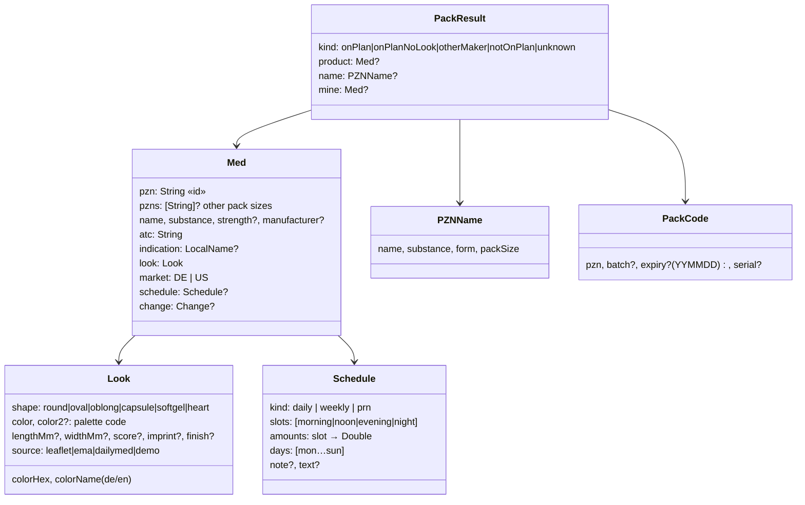

# BlisterKompass architecture

One product, two clients: a SwiftUI iPhone app (`ios/`) and a web app (`pwa/`, plain ES modules, deployed by Vercel's Git integration). Same features, same
rules, same German texts, same bundled data (`AGENTS.md` → “Two clients, one product”). No backend, no settings, no personalisation. Three inputs (a plan code, a
pack code, a pill photo), one bundled catalog, one deterministic matcher. The only state is the patient's medication list on the phone.
The flow below uses the iOS names; the [code map](#code-map-ios--pwa) pairs every iOS file with its PWA module.

## Flow

1. **Photo in.** Every photo (camera, a bundled example or the phone's photo library) goes to `AnalyzingView.run()`. The examples
   (`Examples/`, listed in `examples.json`, shown by `ExamplesView`) are real code images and photos; nothing is drawn or faked.
2. **Plan, pack or pill?** `CodeReader.scan` decodes codes with **zxing-cpp** (Swift package, CPU only, so it also works in the simulator,
   where Apple Vision's barcode model can't run) and Apple Vision as a second opinion on devices:
   - bytes (ISO-8859-1) containing `<MP` → a **Medikationsplan** (BMP Data Matrix) → step 3;
   - a **pack code** → `PackCode.parse`: securPharm IFA `[)>␞06␝9N<PPN>…` or GS1 `(01)04150<PZN>…`, or the Code 39 PZN barcode `-<PZN>`
     on non-prescription packs; PZN check digit verified → step 4;
   - no code → a pill photo → step 5.
   Demo codes: `tools/make-plan-codes.py` and `tools/make-pack-codes.py` (zxing-cpp, round-trip checked).
3. **Plan → my meds.** `PlanReader` parses the BMP XML with `XMLParser` and keeps only `<S>` sections and their `<M>`/`<W>` entries:
   PZN (zero-padded to 8), substance and strength, dosing `m/d/v/h` (also `½`, `1/2`, `0,5`), weekday `wo`, as-needed section
   (`c="411"` or free text "Bedarf…"), weekly section (`c="425"` or "wöchentlich"), free text `t`, hint `i`. `
` (patient), `<A>`
   (practice) and `<O>` (parameters) are skipped during parsing, so they never reach memory or storage. A code that breaks the BMP 2.8
   contract is refused, never read half-way: another version than `028`, a PZN outside 1–99999999, a dose outside the dose notation (never
   read as 0), a weekday outside 1–7, bad pages (the PWA names the reason; iOS also refuses multi-page codes until it can merge pages).
   Entries are resolved against the catalog by PZN only (any pack size of a product), never by substance (INV-05/15); all `<W>` of a
   combination product are kept and a weekly line keeps its dose. The PWA keeps a line without a catalog look with its own PZN, name and
   schedule; iOS still lists it by name only (`TODO.md` T-29). Unresolved entries stay unknown and
   are listed, never guessed. `Store.adopt` replaces `myMeds` and `unknownPZNs`.
4. **Pack → plan.** `PackResult.evaluate` compares the PZN with the plan: `onPlan` · `onPlanNoLook` · `otherMaker` (same substance,
   strength and release type as far as known, other PZN: possibly the pharmacy's switch, never shown as "the same medicine") ·
   `sameSubstance` (same substance, but other strength, other release type such as gastro-resistant vs. plain, or strength unknown) ·
   `notOnPlan` · `unknown`, plus expiry/batch from the code. Strength of name-only packs comes from the PZN name ("ASPIRIN N 100MG"),
   release type from the IFA form code. Names and dosage forms for PZNs without a look come
   from `Data/pzn-names.json`; `DoseForm` turns the form code into a grey outline (tablet, capsule, drops …). `otherMaker` writes
   nothing: there is no "take over the new look", because a person's tap must not replace the plan's PZN (INV-15, T-15). One write is
   possible, by explicit tap:
   - `notOnPlan` (`PackResult.canAdd`) → **Zu meinem Plan hinzufügen**: with a catalog look, `ManualPlanView(adding:)` asks for the
     times of day and `Store.add` appends the entry (same PZN replaces); without a look, `Store.addWithoutLook` adds the PZN to
     `unknownPZNs` and it is listed by its official name.
5. **Pill → cues.** `PillRecognizer` works on the pixels: background = median colour of the photo border; pill = largest region that
   differs from it (shadows ignored, centre favoured); colour = trimmed CIELAB mean → nearest catalog colour (two different halves →
   two-coloured capsule); shape = principal axes + fill ratio → round / oval / oblong; imprint = Apple Vision text recognition on the crop.
6. **Cues → answer.** `Matcher.answer(myMeds:catalog:cues:)`, the deterministic scorer:
   - score each plan entry: imprint 5, colour 3, shape 2.5, size 1.5, score line 1.5, finish 0.5; similar colours/shapes give partial
     credit; an imprint read by OCR also matches look-alike glyphs (I/1/l, O/0, S/5, B/8);
   - rank; candidates within 0.15 of the best are "close". Without a read imprint and a measured size, every plan pill whose colour fits
     (≥ 0.7) and whose shape isn't clearly different is close too (white look-alikes, T-05). 1 → `sure` (≥ 0.75, and only with a read
     imprint; the banner says "Passt zu Ihrem Plan – bitte prüfen", never "Ihre Tablette") or `likely`; several → `choose` (up to 6) plus
     the question with the highest information gain over the close set; none → `unknown`;
   - then rank the **rest of the catalog**. If something not on the plan fits clearly better (≥ 0.7 and > best own + 0.1): same substance
     **and strength** as a plan entry → `other_maker`; same substance in another or unknown strength, or only the same ATC code →
     `other_strength` (shows the look-alike's own title next to the plan entry, T-04); else `not_on_plan`. Near-ties prefer a plan
     substance with the plan's strength and German-market products. The score is a heuristic, not a probability.
7. **Home = the day.** `Day.sections(myMeds, at: now)` turns the plan into sections: the current slot (morning 4–11, noon 11–15,
   evening 15–21, night 21–4) first and marked `now`, then the rest of the day in order, today's slots already past as `past` ("Heute
   vorbei", never "Morgen": T-06), weekly meds whose weekday is today, other weekly meds under "Diese Woche", as-needed last. The day runs
   04:00–04:00: from midnight to 04:00 the night slot is `lastNight` ("seit gestern Abend"), never `now`. "Die App merkt sich nicht, was
   Sie schon genommen haben" sits under the heading and ends the read-aloud. `DayPlanList` renders it (big rows for `now`) and
   refreshes every minute (the PWA with one app-wide timer that redraws only the list). Read-aloud uses a fixed template over the same data.

## Data model

There is deliberately **no type for a person**. Everything below is product or plan data.

| Type | Where | What it is |
|---|---|---|
| `Med` | `Models.swift` | A product from `catalog.json`. On the patient's plan the same struct also carries the plan's `schedule`. Identity is the `pzn` (8 digits; `NDC:…`/`EMA:…` for reference products); `pzns` lists the other pack sizes of the same product. |
| `Look` | `Models.swift` | How the pill looks. Colours are codes from one shared palette (`PillRecognizer.palette`), so recognition and drawing agree. `source` says where it came from and is shown under the picture ("Aussehen laut Packungsbeilage", "US-Referenzdaten", …). What a source does not state stays null. |
| `Schedule` | `Models.swift` | From the BMP: `daily` with slots and amounts, `weekly` with weekday(s), or `prn` (as needed). Built only from plan fields or the user's own taps, never inferred. |
| `ScannedPlan` | `Models.swift` | Result of reading a plan code: `meds` with a look, `unknown` labels and `unknownPZNs` for entries without picture data. |
| `PZNName` | `PackCode.swift` | One row of the official PZN list: `[name, substance, form, pack size]`, e.g. `["ASPIRIN N 100MG", "Acetylsalicylsäure", "TABL", "98"]`. |
| `DoseForm` | `DoseForm.swift` | IFA form code → family (tablet, capsule, drops, injection, patch …) and a German label; drawn as a grey dashed outline, never a coloured pill (INV-05). |
| `PackCode` / `PackResult` | `PackCode.swift` | A decoded pack code and what it means for the plan (see flow step 4). |
| `PillCues` / `Answer` | `Models.swift` | What the recogniser saw, and the matcher's verdict (`sure`, `likely`, `choose`, `other_maker`, `other_strength`, `not_on_plan`, `unknown`, …). |
| `Day.Section` / `Day.Entry` | `Models.swift` | The plan laid out over the day for the home screen; computed, never stored. |

**Stored on the phone** (`UserDefaults`, nothing else): `myMeds` (JSON array of `Med` with schedule) and `unknownPZNs` (array of PZN
strings). A new plan code overwrites both; "add to plan" updates them in place. Photos, plan XML and pack codes are
never stored.

**Bundled, read-only:**

- `Data/catalog.json`, 108 products, the source of truth for pill pictures. 77 came once from the earlier Pill Lens prototype (22 demo
  products with fictional makers, 39 US DailyMed, 16 EMA). `tools/add-leaflet-looks.py` adds 31 real German products (Aspirin N 100 mg,
  HCT 1A Pharma, MTX HEXAL, Naratriptan-ratiopharm, …; 14 of them found by PZN with `tools/fetch-leaflet-looks.py`) with the look stated
  in their package leaflet (PIL §6), the leaflet link in `look.source` and all PZNs of their pack sizes. This public repo ships the
  facts and the link, not the leaflet's own sentence (`look.leaflet` stays empty; [docs/DATA.md](docs/DATA.md)). US reference looks are never used for
  German PZNs.
- **Live leaflet lookup** for any other PZN, when a plan or pack is scanned, after a one-time "Erlauben": `LeafletOnline` downloads the
  leaflet PDF for that PZN, PDFKit extracts the text, `LeafletParser` reads section 6 with the same fixed rules (colour, shape, score,
  imprint, size, capsule halves; strength from the official PZN name). Unclear texts (another strength, several colours, sprays,
  injections) give no look. Found products are kept on the phone (`Store.learned`) and count like catalog products from then on.
- `Data/pzn-names.json`, PZN → `PZNName` for 93 packs: the demo excerpt of the BfArM Festbetrag list (catalog, example and test PZNs;
  [docs/DATA.md](docs/DATA.md)), loaded on first use. Any other pack shows "Packung nicht in der Datenbank" with its PZN.

## Files (`ios/PillSnap/`)

| File | Role |
|---|---|
| `RootView.swift` | app entry, routing (`Route`), home (scan buttons + day plan) / onboarding, analyzing, plan import, building blocks |
| `PlanReader.swift` | BMP XML → plan items → `ScannedPlan` (privacy boundary: only medication lines) |
| `PillRecognizer.swift` | on-device image analysis + OCR → `PillCues` |
| `Matcher.swift` | scoring, ranking, question, other-maker / not-on-plan warnings → `Answer` |
| `Store.swift` | bundled catalog and PZN list; `myMeds` / `unknownPZNs` in UserDefaults; `adopt`, `add`, `addWithoutLook` |
| `Bmp.swift` | code reading (zxing-cpp, Vision): plan or pack code |
| `PackCode.swift` | pack code parser (securPharm IFA/GS1, Code 39 PZN), PZN check, expiry; `PackResult` = pack vs. plan |
| `DoseForm.swift` | dosage form from the PZN list and its grey outline for packs without a look |
| `PackViews.swift` | pack result screen (add to plan), camera / photo-library popup |
| `PlanInput.swift` | "Plan einlesen" popup and the typed-entry screen; also the "when do you take it?" step when adding a scanned pack |
| `OtherViews.swift` | `DayPlanList` (home: now / later), look picker, camera |
| `ResultViews.swift` | result screens, med card |
| `PillView.swift`, `Theme.swift` | pill drawing, colours (light/dark), slots, icons, read-aloud |
| `Models.swift` | data model above, plus `Day` (time-of-day layout) |
| `ExamplesView.swift`, `Examples/` | picker for the bundled example plan codes, pack codes and pill photos (`examples.json` = file, kind, caption) |
| `LeafletLookup.swift` | "Wie sieht das aus?" per medicine, step by step: catalog look, or a live lookup for an unknown PZN |
| `LeafletOnline.swift`, `LeafletParser.swift` | live package-leaflet download for an unknown PZN (after "Erlauben"), section 6 → look with fixed rules |
| `MealTiming.swift` | meal tag (nüchtern / vor / zum / nach dem Essen) from the Hinweise text |
| `PlanPrint.swift`, `BmpWriter.swift` | "Plan drucken": A4 sheet with pill pictures; `BmpWriter` builds a BMP code from the phone's list (to be removed, `TODO.md` T-30) |

Outside the app: `ios/checks/` (offline checks), `ios/eval/` (photo evaluation), `tools/` (demo codes, leaflet looks, test-photo download,
demo print `make-bmp-sheet.py`).

## Code map: iOS ↔ PWA

Every change goes into both columns (`AGENTS.md` → “Two clients, one product”). Data (`ios/PillSnap/Data/`, `Examples/`) is shared: the PWA copies it with
`npm run sync`, and `pwa/tests/pwa.test.js` fails if the copies differ.

| Concern | iOS `ios/PillSnap/` | PWA `pwa/` | Checks |
|---|---|---|---|
| Data model, day view (`Day.sections`), read-aloud templates | `Models.swift` | `js/model.js` | both |
| BMP plan reader (privacy boundary) | `PlanReader.swift` | `js/plan-reader.js` (BMP 2.8 fixes; iOS: T-29) | both |
| Pack codes, PZN check, pack vs. plan | `PackCode.swift` | `js/pack-code.js` | both |
| Matcher: score, rank, question, warnings | `Matcher.swift` | `js/matcher.js` | both |
| Dosage forms, BMP units | `DoseForm.swift` | `js/dose-form.js` (+ KBV forms, Anhang 4 units; iOS: T-29) | both |
| Code reading | `Bmp.swift` (zxing-cpp + Vision) | `js/code-reader.js` (zxing-wasm), `js/vision.js`, `js/vision-worker.js` | both |
| Pill pixels | `PillRecognizer.swift` (+ Vision OCR) | `js/recognizer.js` (no OCR: the imprint is typed; Android app: ML Kit OCR via `js/vision.js` → `MainActivity.readImprint`, pre-fills the field) | PWA (`recognizer.test.js`), iOS (`ios/eval/`) |
| State (`myMeds`, `unknownPZNs`, learned leaflet looks) | `Store.swift` (UserDefaults) | `js/store.js` (localStorage, + `learnedLeaflets`) | PWA (`pwa.test.js`) |
| Meal tags | `MealTiming.swift` (iOS: T-31) | `js/bmp-writer.js` `meal()` | both |
| Plan drucken | `PlanPrint.swift`, `BmpWriter.swift` (iOS: T-30) | `js/print-sheet.js` ("Meine Medikamente mit Bildern", no code); `bmp-writer.js` / `code-writer.js` unused for print (D-09) | PWA (`print.test.js`) |
| Leaflet look for an unknown PZN | `LeafletLookup.swift`, `LeafletOnline.swift` (live download after "Erlauben"), `LeafletParser.swift` | `js/leaflet-parser.js` (1:1 port), `js/leaflet-pdf.js` (the person opens the leaflet link, saves the PDF and picks it; read with vendored pdf.js – no download: the hosts send no CORS headers) | both (`leaflet.test.js`) |
| Screens and building blocks | `RootView`, `ResultViews`, `PackViews`, `PlanInput`, `OtherViews`, `ExamplesView`, `PillView`, `Theme` | `js/app.js`, `js/ui.js`, `js/icons.js`, `app.css` | — |
| Read-aloud | `Theme.swift` (AVSpeechSynthesizer) | `js/speech.js` (speechSynthesis, de-DE) | — |
| Install, offline | App Store / Xcode | `manifest.webmanifest`, `sw.js`, `js/install.js` | PWA (`pwa.test.js`) |
| Offline checks | `ios/checks/main.swift` (86, macOS) | `tests/checks.test.js` + 5 more files (141, CI) | pair new checks by name |

## Privacy guarantees and how they are enforced

| Guarantee | Where |
|---|---|
| Network only for leaflets, only the PZN | the only network call is `LeafletOnline` (HTTPS GET of the package leaflet PDF for a PZN the app doesn't know), and only after the user tapped "Erlauben" once (`Store.onlineLeaflets`). The URL carries the PZN, nothing about the person; no ATS exceptions. With "Nein" the app stays fully offline. |
| No person data | `PlanReader.Collector` ignores `P`/`A`/`O`; `Models.swift` has no person fields; check "KBV sample: no person data read" |
| No photo storage | photos live only in memory for the analysis; only `myMeds` and `unknownPZNs` are written to `UserDefaults` |
| Unknown stays unknown | unresolved plan entries and packs without a look are listed by name with their dosage-form outline, never given a colour or shape from appearance or defaults |

PWA: no network at runtime at all (CSP `connect-src 'self'`, everything served from the service-worker cache; a test fails if any other host
appears in the code, except the two leaflet links the person opens). `localStorage` holds `myMeds`, `unknownPZNs` and `learnedLeaflets`
(products whose look was read from a leaflet PDF the person picked; no person data). The plan's `X` free-text lines are shown at import and never stored.

## Testing

- **PWA** (`cd pwa && npm install && npm test`, Node 22, CI on every PR): 141 tests (incl. `leaflet.test.js`: the iOS leaflet-parser checks by name + PDF → look with a synthetic PDF) – the iOS checks ported one by one plus the BMP 2.8 checks
  (`checks.test.js`), example codes decoded through zxing-wasm (`codes.test.js`), print sheet and meal tags (`print.test.js`), pill
  pixels (`recognizer.test.js`), PWA rules (`pwa.test.js`: CSP, precache, storage keys, data identical to iOS).
- **iOS** (`ios/checks/run.sh`, macOS + `swiftc`, no Xcode test target): 86 checks – plan reader (plan A, KBV sample incl. the spec's
  own figure-6 code, `½`/`1/2`/`0,5`, weekly and as-needed headings, no person data, non-plans), pack codes (IFA, GS1, Code 39, check
  digit, expiry), pack vs. plan, leaflet looks and parser, dosage forms, add-to-plan, day view, meal tags, print, matcher.
- **Photo evaluation** (`ios/eval/run.sh`): the recogniser and matcher on 15 real NLM photos with ground truth (`test-photos/RESULTS.md`).
- **Demo print** (`tools/test_make_bmp_sheet.py`, pytest): BMP page and picture sheet rules; XSD validation and code read-back run in
  `tools/make-bmp-sheet.py` itself.

## Known gaps

The open items, each with problem, fix and test, are in [`TODO.md`](TODO.md). The ones about the rules in [`AGENTS.md`](AGENTS.md) §2:
INV-15/16/19 wording (T-08), INV-21 substitution-exclusion flag (T-16), the iOS ports of the BMP 2.8 fixes (T-29 to T-31) and the BMP
code on patient prints (T-32, [`docs/DECISIONS.md`](docs/DECISIONS.md) D-09). Deployment: Vercel's Git integration (preview per PR,
production on `main`); CI: [`.github/workflows/ci.yml`](.github/workflows/ci.yml).
