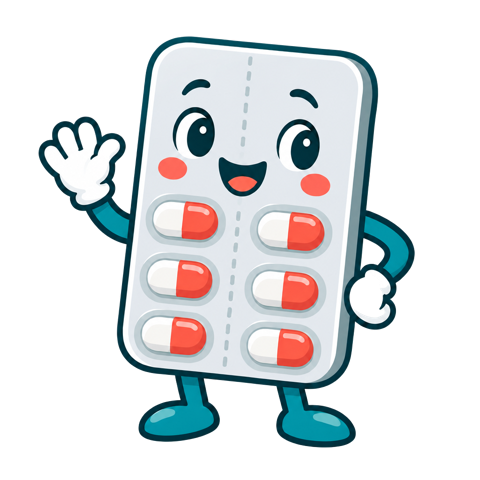
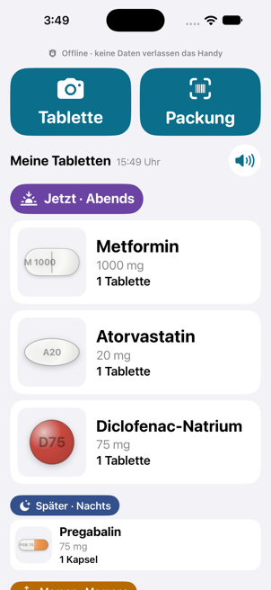
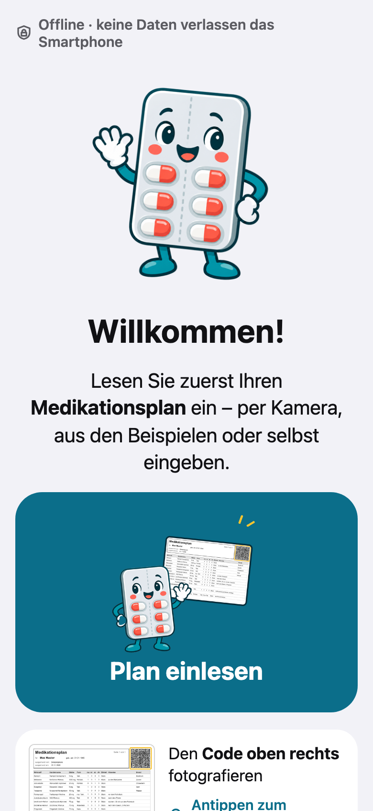
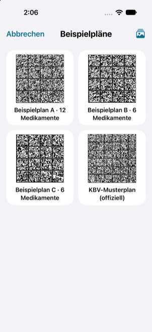
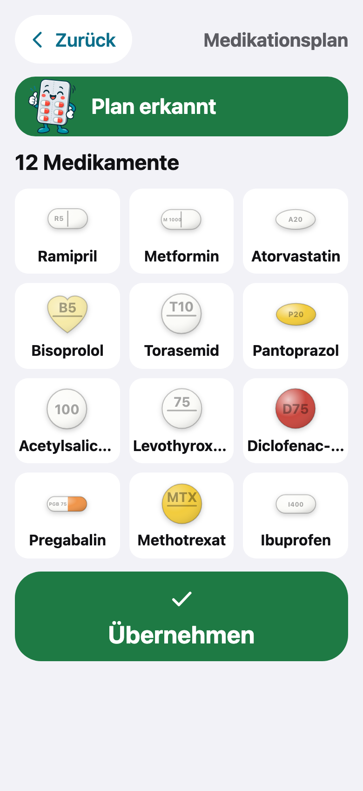
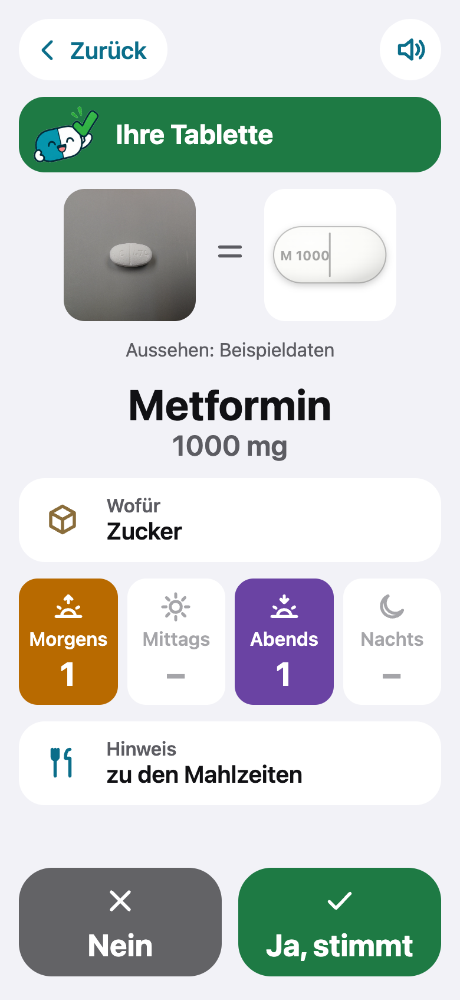
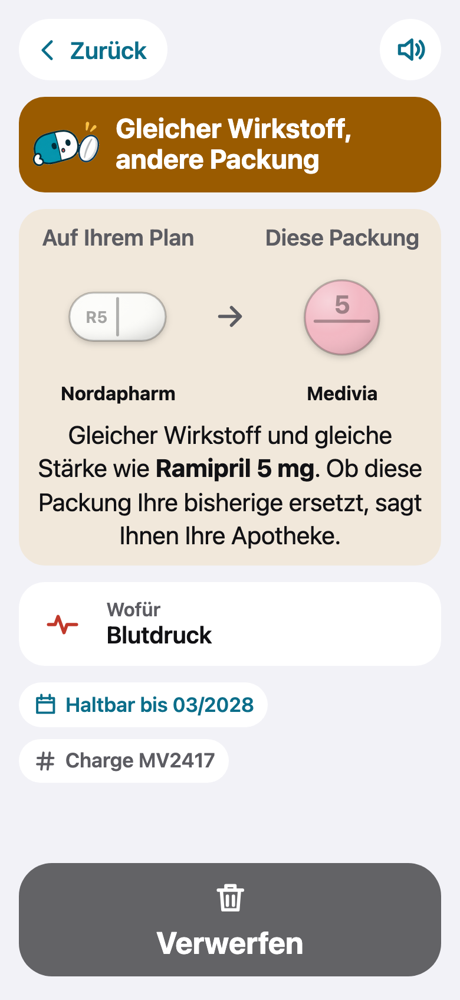
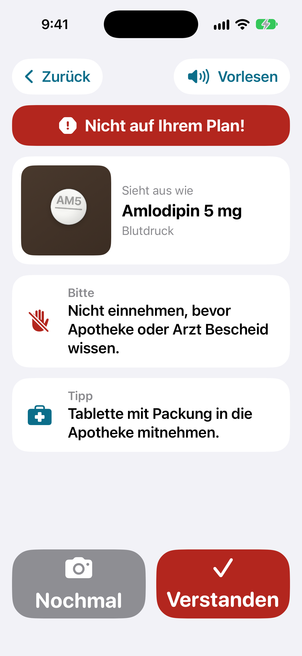

# BlisterKompass



**Welche Tablette ist das, wofür ist sie, und wann nehme ich sie?** BlisterKompass helps older people on many medicines, and the people
who look after them, read the German medication plan (BMP) and recognise their own pills, without a server, an account or a
physician app. Scan the 2D code on the paper Medikationsplan once. From then on there are two ends:

| For | What | Where |
|---|---|---|
| **The older person** (e.g. Erika M., 78, twelve medicines, cataract) | A large-print sheet **"Meine Medikamente mit Bildern"** next to the paper plan: one numbered row per medicine, a picture of each pill, the times of day in words. Printed from the app as an A4 PDF. | [PRD](docs/PRD-print-sheet.md) · [examples](print/) |
| **The carer or skilled patient** (daughter, home-care nurse, a patient used to phones) | The **mobile app with a scanner**: plan code → today's pills by the clock, pack code → exact identity by PZN, pill photo → candidates with "ask the pharmacy" when in doubt. Read-aloud, offline. | [PRD](docs/PRD-scanner-app.md) · [web app](https://blisterkompass.vercel.app/pwa/) |

Live: <https://blisterkompass.vercel.app> (landing page, German and English) · app: <https://blisterkompass.vercel.app/pwa/>

Built at the Healthcare Hackathon Bayern 2026 in Erlangen (Challenge 1, "Medication adjustment with polypharmacy patients",
BioMedical Design / Novo Nordisk Foundation). **Synthetic hackathon prototype: not for clinical use; medical-device qualification not
yet assessed. Synthetic demo data only.** Identity comes from the plan's PZN, a scanned pack or a pharmacist; a photo only suggests.

## The app: one product, two clients

| | iPhone app | Web app (PWA) |
|---|---|---|
| Code | [`ios/`](ios/) (SwiftUI) | [`pwa/`](pwa/README.md) (plain ES modules, no build step) |
| Get it | Xcode 26 → simulator or your iPhone ([below](#install-the-iphone-app)) | open the [web app](https://blisterkompass.vercel.app/pwa/) → "Zum Home-Bildschirm" |
| Tests | `ios/checks/run.sh` (86 checks, macOS) | `cd pwa && npm install && npm test` (141 tests, CI on every PR) |
| Differs | imprint read by OCR; leaflet lookup online after consent | imprint typed; offline: the person opens the leaflet and picks the PDF, read on the phone; ahead on BMP 2.8 reading and the print sheet ([TODO](TODO.md) T-29…T-31) |

Every feature and fix goes into both clients ([`AGENTS.md`](AGENTS.md) → “Two clients, one product”). The iOS ↔ PWA code map is in
[ARCHITECTURE.md](ARCHITECTURE.md#code-map-ios--pwa); open work, each item with problem, fix and test, is in [TODO.md](TODO.md).

Screens (web app at iPhone size, example plan A, 14 Nov 2026):

| Home: now / later | Welcome | Example codes | Plan read | Your pill | Different maker | Not on plan |
|---|---|---|---|---|---|---|
|  |  |  |  |  |  |  |

**Private by design.** Everything runs on the phone. The web app makes no network request after the first load; the iPhone app fetches
a package leaflet for an unknown PZN only after the user taps "Erlauben" (only the PZN leaves the phone). From the plan the app reads
only the medication lines: name, birth date, insurance number and practice are never read or stored. Photos are not saved.

## Use

1. **Plan einlesen.** **Kamera** (photo of the 2D code on the plan), **Beispiele** (bundled example plan codes, plus the phone's own
   photos) or **Selbst eingeben** (type a name, tap the match, tap the times of day). Works with any BMP 2.8 code; entries without a
   picture keep their dose and times and show a grey outline. Plans over several pages are merged. A new plan replaces the old list.
2. **Home = my day.** The plan by the clock: **Jetzt** first with big pill pictures, then **Später** and today's past slots as **Heute vorbei** (never "Morgen"), weekly medicines in
   their slot on their day (otherwise "Einmal pro Woche" with the next date), free-text dosing as written, as-needed last. The speaker
   button reads out what is due now. Tap a pill for its card: dose, unit, reason and notes as the plan states them.
3. **Tablette.** One pill on a dark, plain surface, photographed from above. Answers: probably yours (with "Ja, stimmt" / "Nein"),
   **Welche ist es?** (candidates plus the one question that tells them apart), **Anders als auf Ihrem Plan** (probably another maker:
   ask the pharmacy) or **Nicht auf Ihrem Plan!** (ask before taking it).
4. **Packung.** Scan the securPharm Data Matrix on the box, or the PZN barcode on non-prescription packs. The PZN gives exact identity:
   on your plan · same substance, other pack (only the pharmacy says whether it replaces yours) · same substance, other strength or form ·
   not on your plan (can be put on your own list) · not in the database. Best-before date and batch from the code, **Abgelaufen** when expired.
5. **Plan drucken.** The sheet "Meine Medikamente mit Bildern" for the older person (A4 landscape, large print, no 2D code of its own):
   each pill at true size and enlarged, the plan's Hinweis as written with a meal or weekday tag, "Sieht aus wie Nr. …" for look-alikes.
   The paper BMP from the practice stays the valid plan.
6. **Sprachberater (bonus).** The button top right opens the voice advisor, a separate web app
   (<https://blister-kompass-voice.vercel.app/voice>), in the browser after a short note: describe a medicine in words, it shows possible
   matches to check. With the microphone the voice goes to an online speech service; BlisterKompass itself stays offline.

No settings, no account, nothing personal. Big buttons with icon and word, read-aloud, light and dark mode. German UI.

## Quick start

**Web app** (no build step), from the repo root:

```bash
python3 -m http.server 8090      # then open http://localhost:8090/pwa/ (landing page: /docs/landing.html)
cd pwa && npm install && npm test   # 141 tests, Node 22 (without the install, the 3 leaflet-PDF tests are skipped)
```

### Install the iPhone app

A Mac with Xcode 26 or newer, iOS 17+ on the phone or simulator. The only dependency, the
[zxing-cpp](https://github.com/zxing-cpp/zxing-cpp) Swift package (3.1.1, pinned), is fetched by Xcode on the first build. The Xcode
project and target are still called `PillSnap` internally (T-43); the app shows as **BlisterKompass**.

```bash
open ios/PillSnap.xcodeproj      # scheme PillSnap → any iPhone simulator → Run
```

On your own iPhone (a free Apple ID is enough): select the target → Signing & Capabilities → Team, connect the phone, enable Developer
Mode, Run. Change the bundle ID `de.blisterkompass.app` if Xcode says it is taken. From the command line:

```bash
cd ios
xcodebuild -project PillSnap.xcodeproj -scheme PillSnap -destination 'generic/platform=iOS' \
  -derivedDataPath build -allowProvisioningUpdates DEVELOPMENT_TEAM=<your team id> build
xcrun devicectl device install app --device <device id> build/Build/Products/Debug-iphoneos/PillSnap.app
```

Demo inputs ship with both clients ([`ios/PillSnap/Examples/`](ios/PillSnap/Examples/README.md): plan codes, pack codes, pill photos);
**Beispiele** opens them and they go through the same recognition as a camera photo. To demo with paper, print a plan code from
`ios/PillSnap/Examples/plans/*.png` and point the camera at it.

## Develop

```bash
cd pwa && npm install && npm test     # web app: 141 tests; CI runs them on every PR
cd pwa && npm run sync                # after editing ios/PillSnap/Data or Examples: copy them into the web app (a test checks they match)
ios/checks/run.sh                     # iPhone app: 86 offline checks (macOS, swiftc); pair new checks with pwa/tests/checks.test.js
python3 -m pytest -q tools/test_make_bmp_sheet.py   # print generator rules (pip install zxing-cpp==3.1.1 pillow xmlschema pytest)
python3 -I tools/make-bmp-sheet.py    # demo print: BMP page + picture sheet per plan → print/ (also needs pypdfium2 and Chrome)
python3 -I tools/make-plan-codes.py   # Data Matrix codes for the example plans (zxing-cpp + pillow)
node tools/fetch-test-photos.js       # 15 real NLM pill photos with ground truth → test-photos/ (not committed)
ios/eval/run.sh                       # recogniser + matcher on those photos → test-photos/RESULTS.md
```

Read first: [AGENTS.md](AGENTS.md) (rules, also for coding agents), [CONTRIBUTING.md](CONTRIBUTING.md), [ARCHITECTURE.md](ARCHITECTURE.md).

## Repository layout

```
ios/            iPhone app (SwiftUI). PillSnap/Data (catalog, PZN demo list) and PillSnap/Examples are the source of truth for both
                clients; checks/ offline checks; eval/ photo evaluation
pwa/            web app: js/ modules paired with the Swift files, tests/ (node --test), data/ + examples/ synced from ios/,
                vendor/zxing-wasm, sw.js (offline), icons/ (mascot art)
docs/           PRDs, decisions, data provenance, landing page (DE/EN), screenshots, brand, research notes
print/          example sheets: the BMP page and "Meine Medikamente mit Bildern" for plan A and the KBV sample
tools/          generators: example plan and pack codes, leaflet looks, demo print (+ tests), test-photo download
android/        Android app: the web app in an offline WebView (no internet permission); build-apk.sh → android/dist/, published as a release asset
deploy/         build.py → deploy/dist (landing page + web app), what Vercel publishes
test-photos/    NLM ground truth (manifest.json) and RESULTS.md
```

## Deploy

Vercel's Git integration builds every PR as a preview and `main` as production at <https://blisterkompass.vercel.app>.
[`vercel.json`](vercel.json) holds the build (`python3 deploy/build.py`), the output (`deploy/dist`, landing page + web app only), the
`/` → landing redirect and the headers. GitHub Actions ([`.github/workflows/ci.yml`](.github/workflows/ci.yml)) runs the web-app tests,
the site build with a data guard and the print tests on every PR and on `main`. `docs/landing.html` is a fragment; `deploy/build.py`
wraps it in a full page and swaps Google Fonts for the self-hosted font in `docs/fonts/`, so visitors' IP addresses don't go to Google.
The Android APK (debug-signed, for sideloading) is not committed: it is the asset of the latest GitHub release
(<https://github.com/Rebell-Leader/BlisterKompass/releases/latest/download/blister-kompass.apk>), which the landing page links to.
Rebuild it with `android/build-apk.sh` (JDK 17, Android SDK 35) after web-app changes, then `gh release upload <tag> android/dist/blister-kompass.apk --clobber`.

## Data and licences

Code: [MIT](LICENSE). Details on every dataset and what was cut for this public repo: [docs/DATA.md](docs/DATA.md).

| Data | Source | Licence / basis |
|---|---|---|
| Pill looks, demo products (22) | synthetic, fictional makers | – |
| Pill looks, US products (39) | FDA/NLM DailyMed | US public domain |
| Pill looks, EU products (16) | EMA product information | reuse with attribution |
| Pill looks, German products (31) | package leaflet §6 of each product: the facts (colour, shape, size, imprint), source link in `look.source`; no quotes | facts with source |
| PZN → name, substance, form, pack size (93 rows) | excerpt of BfArM, Festbetragsarzneimittel nach § 35 SGB V, Stand 01.11.2026 | official publication; demo excerpt only |
| Example pill photos | NLM C3PI | US public domain |
| KBV sample plan, BMP key tables (dosing units, dosage forms) | KBV BMP specification 2.8 | free to reuse |
| Example plans A–C, pack codes | synthetic | – |
| Barcode reading | [zxing-cpp](https://github.com/zxing-cpp/zxing-cpp) 3.1.1 (iOS), [zxing-wasm](https://github.com/Sec-ant/zxing-wasm) 3.1.6 (web) | Apache-2.0, MIT |
| PDF reading (web, leaflet the person picks) | [pdf.js](https://github.com/mozilla/pdf.js) 4.10.38, `pwa/vendor/pdfjs/` | Apache-2.0 |
| Font | Atkinson Hyperlegible | SIL OFL 1.1 |
| Mascot and action-icon art (`pwa/icons/mascot-*.png`; the blister in `scan-plan`; `pwa/icons/ui-*.png`) | © Anna P. (AnnXQP) | used with permission for this project |
| Pill-camera action icon for "Tablette" (`pwa/icons/ui-pill.png`, `ios/PillSnap/Assets.xcassets/ui-pill`; source `docs/brand/tablette-scan.jpeg`) | supplied by the team, 14 Nov 2026 | project asset |
| Plan-code hint pictures (`pwa/img/plan-hint*.png`, `ios/PillSnap/Assets.xcassets/plan-hint*`) | drawn by `tools/make-plan-hint.py` from example plan A (synthetic) | project asset |
| Pill mascot states (`pwa/img/mascot/`, `ios/PillSnap/Assets.xcassets/mascot-*`) | generated with ChatGPT for this project, cut and drawn by `docs/brand/pill-mascot/*.py` | project asset |

No real patient data anywhere.

## Limits

- Appearance only suggests. Identity comes from the plan's PZN, a scanned pack or a pharmacist.
- Real photos are hard: right medicine in 3 of 15 NLM test photos (white pills on white paper fail). Use a dark surface.
- Pictures exist for the 108 catalog products only. Other medicines show a grey outline of their dosage form, never a guessed pill.
- Size isn't estimated (no reference object); a score line is asked for, not detected.
- "Jetzt / Später" follows the phone's clock and the plan; intake is not recorded.
- Putting a pack on your own list is not a regimen change; that stays with the physician.
- Known gaps, each with a fix: [TODO.md](TODO.md).

## Credits

Team at the Healthcare Hackathon Bayern 2026: Airat Valiev ([@Rebell-Leader](https://github.com/Rebell-Leader)), BenniWie, Sumayya-AK,
brivdan, Anna P. (AnnXQP, mascot art), Lewin98. Formerly "Pill Snap".

## Docs

[PRD: print sheet](docs/PRD-print-sheet.md) · [PRD: scanner app](docs/PRD-scanner-app.md) · [Decisions](docs/DECISIONS.md) ·
[Data](docs/DATA.md) · [Architecture](ARCHITECTURE.md) · [TODO](TODO.md) · [Web app](pwa/README.md) · [Contributing](CONTRIBUTING.md) ·
[Agents](AGENTS.md)
